# Multiplicação de matrizes com MPI e OpenBLAS no cluster Lovelace

**Aluno:** Gabriel Morais Alves (RA: 323616) · **Disciplina:** Computação de Alto Desempenho · **Prof.:** Hervé Yviquel · UNICAMP, novembro de 2026

**Repositório:** `github.com/GabrielmAlves/masters-hpc-mpi`. Os resultados correspondem ao commit `3ab0661`; os dados brutos estão em `results/`.

---

## 1. Introdução

O trabalho calcula **C = A × B** para matrizes quadradas densas de `float` (N×N) de três formas:

1. **Serial**, sem bibliotecas, com três ordens de laço: `ijk`, `ikj` e em blocos b×b (`blocked`).
2. **MPI**: P processos, cada um com uma faixa de linhas, multiplicando com o kernel em blocos.
3. **MPI + OpenBLAS**: mesma distribuição, mas a conta local é feita pela rotina `cblas_sgemm`.

O objetivo é verificar se os resultados estão corretos e medir no cluster Lovelace (CENAPAD-SP) como o desempenho varia com o tamanho da matriz (N), o tamanho do bloco (b), o número de processos (P) e a divisão entre processos MPI e threads do OpenBLAS. Os experimentos incluem escalabilidade forte e fraca, em **um nó de 128 núcleos**, e uma comparação entre um e dois nós (seção 5.7).

---

## 2. Implementação

### 2.1 Organização

O código é C++17, dividido em módulos com cabeçalho (`include/*.hpp`) e implementação (`src/*.cpp`), num único executável `matmul`. O modo é escolhido com `--mode serial | mpi | mpi_blas`.

| Módulo | Responsabilidade |
|---|---|
| `config` | Lê e valida os argumentos (`--n`, `--block`, `--reps`, `--verify`, `--kernel`, `--blas-threads`, `--seed`) |
| `matrix` | Tipo `Matrix` (um `std::vector<float>` contíguo, *row-major*, elemento (i, j) em `i*N + j`) e geração pseudoaleatória reprodutível em [−1, 1] |
| `kernels` | `multiply_ijk`, `multiply_ikj`, `multiply_blocked` e `multiply_blocked_blas` |
| `distribution` | Divisão das linhas entre processos (`counts` e `displs` para `Scatterv`/`Gatherv`) |
| `verify` | Referência em `double` e erro relativo |
| `timing` | Tempos por etapa e saída em CSV |
| `main` | Orquestra: gera, distribui, multiplica, coleta, mede e verifica |

A matriz é guardada num único bloco contíguo de memória, porque é o formato que as funções do MPI e do BLAS recebem (ponteiro + tamanho). Usamos a API em C do MPI, já que as *bindings* C++ foram removidas no MPI-3.

### 2.2 Decomposição: faixas de linhas

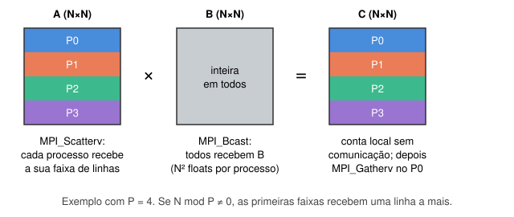

A estratégia adotada divide **A e C em faixas horizontais** e replica **B inteira** em todos os processos:

1. O processo 0 gera A e B.
2. `MPI_Bcast` envia B inteira a todos.
3. `MPI_Scatterv` envia a cada processo a sua faixa de linhas de A.
4. Cada processo calcula a sua faixa de C: `C_local = A_local × B`. Não há comunicação durante a conta.
5. `MPI_Gatherv` junta as faixas de C no processo 0.

**Tratamento de restos.** Se N não é múltiplo de P, os `N mod P` primeiros processos recebem uma linha a mais (`distribute_rows`). Por isso usamos as versões `v` (`Scatterv`/`Gatherv`), que aceitam tamanhos diferentes por processo. Os blocos de borda são tratados com `min(ii + b, limite)` em cada laço, então N não precisa ser múltiplo de b. Os dois casos foram testados: P = 3 deixa resto nas linhas, e N = 6000 com b = 64 gera blocos de borda de 48.

A estratégia é simples e não precisa de comunicação durante o cálculo. O custo é que **cada processo guarda B inteira** (N² floats) e que todo o tráfego passa pelo processo 0. As consequências aparecem nos resultados (seção 6). Algoritmos como SUMMA e Cannon distribuem também B e evitam esse gargalo; ficam como trabalho futuro.

### 2.3 Kernels locais

- **`ijk`**: o laço mais interno percorre uma **coluna** de B (`B[k*N + j]` com k variando), saltando N floats a cada iteração. Quase todo acesso é uma falta de cache.
- **`ikj`**: troca a ordem dos dois laços internos. O laço interno passa a percorrer **linhas** contíguas de B e C, o que aproveita as linhas de cache e permite vetorizar.
- **`blocked`**: seis laços. Os três externos percorrem blocos b×b; os três internos fazem `ikj` dentro do bloco. Um bloco de A, um de B e um de C (3·b²·4 bytes) ficam na cache enquanto são reutilizados. Com b = 64 os três blocos ocupam 48 KiB, e com b = 128, 192 KiB; os dois cabem na L2 de 512 KiB do EPYC 7662.
- **`blocked_blas`**: mesma estrutura de blocos, mas cada produto de blocos é uma chamada `cblas_sgemm(RowMajor, NoTrans, NoTrans, …, beta = 1)`. O *leading dimension* é sempre N, porque os blocos são janelas dentro da matriz inteira. Com `--block ≥ N` sobra **uma única chamada** com a faixa local inteira, e o OpenBLAS faz a própria blocagem.

### 2.4 Compilação

Release (`-O3`) com `-march=x86-64-v3` (AVX2, suportado pelo EPYC 7662 e pela máquina de desenvolvimento) e `-ffp-contract=off`. A segunda opção impede o compilador de fundir multiplicação e soma em FMA. Sem ela, o GCC usava FMA nos kernels `ikj` e `blocked` mas não no `ijk`, e os três deixavam de dar resultados idênticos bit a bit.

O OpenBLAS do Lovelace só existe como biblioteca estática compilada com OpenMP. Por isso o `CMakeLists.txt` localiza a biblioteca com `find_library` e liga explicitamente `OpenMP::OpenMP_CXX`, em vez de usar `find_package(BLAS)`.

---

## 3. Validação

### 3.1 Procedimento

Com `--verify`, na primeira repetição o processo 0 calcula uma **referência em `double`** (laço `ikj` com acumulação em precisão dupla) a partir das mesmas A e B e compara com o C obtido:

  erro relativo = ‖C − C_ref‖_F / ‖C_ref‖_F   (norma de Frobenius)

O resultado é aceito se o erro relativo ficar **abaixo de 10⁻⁴**. A norma de Frobenius resume a matriz inteira num número e não sofre com elementos próximos de zero, como aconteceria com um erro relativo elemento a elemento.

**Justificativa da tolerância.** Em `float`, o arredondamento unitário é u = 2⁻²⁴ ≈ 6·10⁻⁸. Cada elemento de C é uma soma de N produtos. Com erros de arredondamento independentes, o erro relativo esperado cresce como u·√N: cerca de 2,7·10⁻⁶ para N = 2000 e 4,6·10⁻⁶ para N = 6000. A tolerância de 10⁻⁴ dá uma margem de mais de 20 vezes sobre essa estimativa e ainda assim detecta qualquer erro real de indexação ou de distribuição, que produz erros de ordem 1.

O tempo de verificação é medido à parte (`t_verif`) e **não entra** nos tempos de desempenho. As execuções de desempenho rodaram sem `--verify`.

### 3.2 Resultados

Todas as 21 execuções do experimento de corretude passaram (`ok = 1`), assim como os 6 testes de fumaça do build.

| N | serial / mpi (P = 1, 3, 4) | mpi_blas (P = 1, 3, 4) | t_verif (s) |
|---|---|---|---|
| 2000 | 8,01·10⁻⁷ | 1,74·10⁻⁷ | ≈ 2,1 |
| 4000 | 1,13·10⁻⁶ | 2,01·10⁻⁷ | ≈ 21 |
| 6000 | 1,39·10⁻⁶ | 2,25·10⁻⁷ | ≈ 68 |

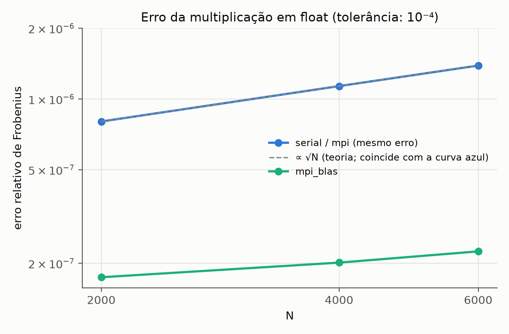

Observações:
- **O modo `mpi` dá exatamente o mesmo erro que o serial**, em todos os dígitos, para P = 1, 3 e 4. A distribuição não muda a ordem das somas de cada elemento, então o resultado é idêntico bit a bit. Isso confirma que a distribuição e a coleta estão corretas.
- **O erro cresce como √N**: de N = 2000 para 4000 ele aumenta 1,41 vezes (√2 ≈ 1,414), e de 4000 para 6000, 1,23 vezes (√1,5 ≈ 1,22). O valor fica em cerca de 0,3·u·√N.
- **O `sgemm` erra de 4 a 6 vezes menos.** O OpenBLAS usa FMA (um arredondamento por multiplicação-soma em vez de dois) e acumula em blocos, o que encurta as cadeias de soma. Nos modos `mpi_blas` o erro varia ligeiramente com P (de 1,7436 a 1,7445·10⁻⁷ para N = 2000), porque o tamanho da faixa muda a blocagem interna do OpenBLAS.
- A verificação é O(N³) em `double` e chega a 68 s para N = 6000, mais do que a própria multiplicação serial. Isso justifica deixá-la fora do tempo medido e rodá-la só uma vez por configuração.

---

## 4. Configuração experimental

### 4.1 Hardware (nó de cálculo do Lovelace)

Obtido com `lscpu` e `free -h` num job interativo.

| Item | Valor |
|---|---|
| CPU | 2 × AMD EPYC 7662 (Zen 2), 64 núcleos cada, ~2,0 GHz base, sem SMT |
| Núcleos por nó | 128 |
| NUMA | 8 domínios de 16 núcleos |
| Cache | L1d 32 KiB e L2 512 KiB por núcleo; L3 16 MiB por grupo de 4 núcleos (CCX) |
| SIMD | AVX2 + FMA (2 unidades FMA de 256 bits por núcleo) |
| Memória | 502 GiB por nó |

O pico teórico em precisão simples é 32 FLOP por ciclo por núcleo (2 FMA × 8 floats × 2 operações). Isso dá 64 GFLOP/s por núcleo a 2,0 GHz, ~105 GFLOP/s no boost de 3,3 GHz, e 8,2 TFLOP/s por nó na frequência base.

### 4.2 Software

| Item | Versão |
|---|---|
| Compilador | GCC 12.2.0 |
| MPI | Open MPI 5.0.6 |
| OpenBLAS | 0.3.21 (target `zen2`, estático, threads via OpenMP) |
| CMake | 3.31.8 |
| Flags | `-O3 -march=x86-64-v3 -ffp-contract=off -Wall -Wextra` |

### 4.3 Threads do OpenBLAS

**Em todos os experimentos, exceto o híbrido, o OpenBLAS usou 1 thread por processo MPI.** Isso foi fixado de três formas, porque o OpenBLAS do Lovelace (OpenMP) obedece a `OMP_NUM_THREADS` e ignora `OPENBLAS_NUM_THREADS`:

- `export OMP_NUM_THREADS=1` no script;
- `export OPENBLAS_NUM_THREADS=1` no script;
- `openblas_set_num_threads(1)` no programa, que é o padrão de `--blas-threads`.

O valor efetivo, lido com `openblas_get_num_threads()`, foi gravado na coluna `blas_threads` de cada linha do CSV. O build confirmou que o controle funciona: `hello_blas` imprimiu 4 threads com `OMP_NUM_THREADS=4`, e `--blas-threads 4` gravou `blas_threads = 4`. No experimento híbrido, T variou de 1 a 16, sempre com P × T = 128.

### 4.4 Execução e medição

- **Fila `par128`**: cada experimento é um job que reserva o nó inteiro (128 núcleos) e roda todos os valores de P em sequência. Todos os P usam o mesmo hardware, sem outros jobs no nó.
- **Afinidade**: `mpirun --bind-to core --map-by core`, um processo fixo por núcleo, preenchendo os núcleos em ordem. Assim, P ≤ 16 fica num único domínio NUMA e P ≤ 64 num único soquete. No híbrido, `--map-by slot:PE=T` reserva T núcleos seguidos por processo, e o `--report-bindings` confirmou a ligação (por exemplo, com P = 8 e T = 16, cada processo ficou com 16 núcleos de um único domínio).
- **O que entra no tempo**:
  - `t_dist` = `MPI_Bcast(B)` + `MPI_Scatterv(A)`;
  - `t_comp` = multiplicação local;
  - `t_gather` = `MPI_Gatherv(C)`.

  Cada etapa é medida com `MPI_Wtime` depois de um `MPI_Barrier` e reduzida pelo **máximo entre os processos** (`MPI_Reduce` com `MPI_MAX`), porque o processo mais lento define o tempo da etapa. O **tempo total** é `t_total = t_dist + t_comp + t_gather`.
- **O que não entra no tempo**: geração das matrizes, verificação e escrita do CSV.
- **Repetições e estatística**: 5 repetições por configuração. As tabelas e os gráficos mostram a **mediana**, e as barras de erro vão do mínimo ao máximo. Antes de cada repetição C é zerada, porque os kernels acumulam em C.
- **Referência para o speedup**: o **próprio programa com P = 1** no mesmo modo e com o mesmo b, ou seja, T(1) do `mpi` para o `mpi`, e T(1) do `mpi_blas` para o `mpi_blas`. A versão serial com o mesmo kernel serve de controle. Para N = 6000 e b = 128, o serial leva 19,05 s e o `mpi` com P = 1 leva 19,07 s, então o custo do MPI com um processo é desprezível.
- **Desempenho**: GFLOP/s = 2N³ / t_total / 10⁹.

| Job | Experimento | Fila | Nó | Execuções |
|---|---|---|---|---|
| 1035720 | Corretude | `testes` (4 núcleos) | adano58 | 21 |
| 1035726 | Kernels seriais | `serial` (1 núcleo) | adano58 | 75 |
| 1035721 | Tamanho de bloco | `par128` | adano37 | 165 |
| 1035722 | Escalabilidade forte | `par128` | adano37 | 260 |
| 1035723 | Tamanho da matriz | `par128` | adano37 | 135 |
| 1035724 | Escalabilidade fraca | `par128` | adano47 | 120 |
| 1035725 | Híbrido | `par128` | adano37 | 25 |
| 1035879 | Número de nós | `paralela` (2 nós) | adano08, adano14 | 100 |

O experimento serial rodou na fila `serial`, com 1 núcleo reservado, num nó que pode ser compartilhado com outros jobs. Os tempos dele são comparáveis entre si, mas não diretamente com os da `par128`: por exemplo, o `blocked` com b = 128 e N = 2000 levou 0,77 s na fila `serial` e 0,71 s no job de escalabilidade forte.

---

## 5. Resultados

### 5.1 Versão serial: ordem dos laços

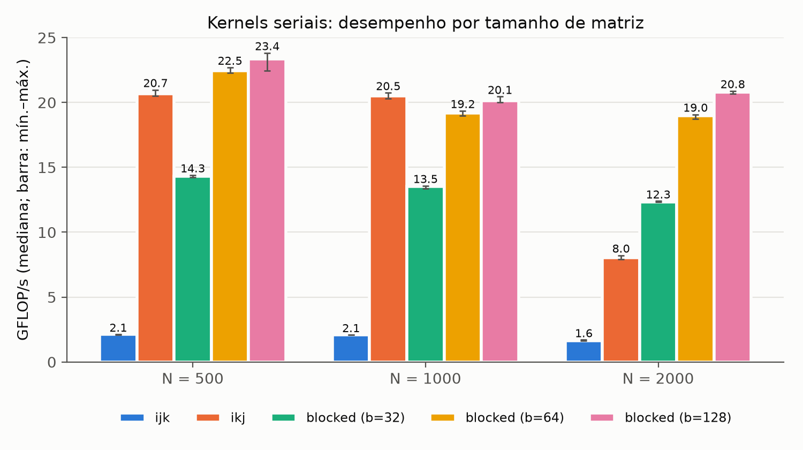

| N | `ijk` | `ikj` | `blocked` b = 32 | b = 64 | b = 128 |
|---|---|---|---|---|---|
| 500 | 0,118 s (2,1 GF/s) | 0,012 s (20,7) | 0,017 s (14,3) | 0,011 s (22,5) | 0,011 s (23,4) |
| 1000 | 0,961 s (2,1) | 0,098 s (20,5) | 0,148 s (13,5) | 0,104 s (19,2) | 0,099 s (20,1) |
| 2000 | 9,70 s (1,6) | 1,99 s (8,0) | 1,30 s (12,3) | 0,84 s (19,0) | **0,77 s (20,8)** |

- Trocar `ijk` por `ikj` deixa o código **cerca de 10 vezes mais rápido** para N ≤ 1000 (5 vezes para N = 2000), sem mudar o número de operações. A diferença vem só do padrão de acesso à memória.
- O `ikj` cai de 20,5 para 8,0 GFLOP/s entre N = 1000 e N = 2000. Com N = 1000, B ocupa 4 MiB e cabe na L3 de 16 MiB; com N = 2000, B ocupa 16 MiB, e cada linha de A percorre B inteira saindo da L3.
- O kernel em blocos mantém cerca de 20 GFLOP/s com N = 2000, porque reutiliza cada bloco enquanto ele está na cache. Para N = 2000 ele é 12,6 vezes mais rápido que o `ijk`.
- O melhor b serial foi **128**, dentro da faixa prevista pela L2 (3 blocos ≤ 512 KiB → b ≤ 209). Com b = 32 o laço interno tem só 32 floats (4 vetores AVX2) e o custo de controle dos laços pesa.

### 5.2 Influência do tamanho do bloco b

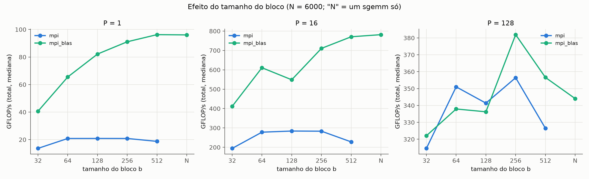

N = 6000, mediana de t_total (s):

| b | `mpi` P = 1 | `mpi` P = 16 | `mpi_blas` P = 1 | `mpi_blas` P = 16 |
|---|---|---|---|---|
| 32 | 31,68 | 2,22 | 10,63 | 1,05 |
| 64 | 20,74 | 1,55 | 6,60 | 0,71 |
| 128 | **20,71** | **1,52** | 5,26 | 0,79 |
| 256 | 20,73 | 1,53 | 4,74 | 0,61 |
| 512 | 23,07 | 1,90 | 4,49 | 0,56 |
| N (1 chamada) | — | — | **4,50** | **0,55** |

- **Kernel próprio (`mpi`)**: o desempenho fica estável entre b = 64 e b = 256. Com b = 32, o custo dos laços domina (+53%). Com b = 512, os três blocos ocupam 3 MiB, muito acima da L2, e o tempo cresce 11%. O ótimo está na faixa em que **os três blocos cabem na L2**, de acordo com a previsão. Os experimentos seguintes usam b = 64 e b = 128.
- **OpenBLAS (`mpi_blas`)**: quanto maior o bloco, melhor, e **uma única chamada com a faixa inteira é o ideal**. O `sgemm` já faz a própria blocagem e empacotamento para a hierarquia de caches. Blocos externos pequenos só geram muitas chamadas pequenas, cada uma com custo fixo e sem espaço para o OpenBLAS otimizar. Com b = 32 o `sgemm` fica 2,4 vezes mais lento que com uma chamada. Os demais experimentos com `mpi_blas` usam uma chamada por processo (b ≥ N).
- **Com P = 128** os valores do job de blocos são ruidosos e não seguem o padrão (gráfico da direita). O tempo nessa faixa é dominado pela comunicação (seção 5.4), não pelo kernel, e o job teve uma variação alta (seção 7.3).

### 5.3 Influência do tamanho da matriz N

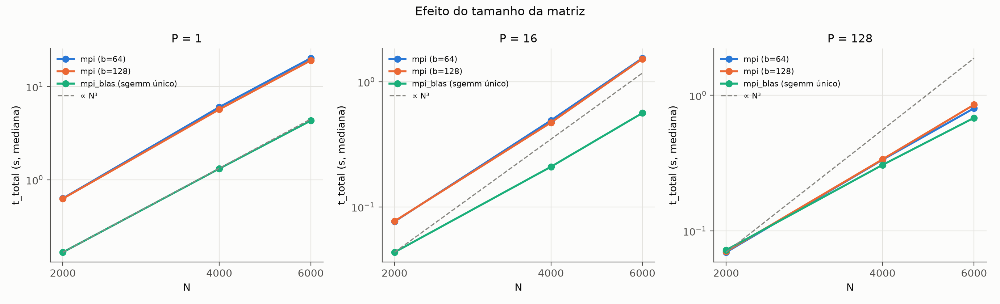

| | N = 2000 → 4000 (×8 operações) | N = 4000 → 6000 (×3,375) |
|---|---|---|
| `mpi` b = 128, P = 1 | 0,626 → 5,69 s (×9,1) | 5,69 → 19,09 s (×3,36) |
| `mpi_blas`, P = 1 | 0,166 → 1,31 s (×7,9) | 1,31 → 4,31 s (×3,28) |
| `mpi` b = 128, P = 128 | 0,070 → 0,337 s (×4,8) | 0,337 → 0,853 s (×2,5) |

Com P = 1 o tempo cresce como N³, como esperado. O GFLOP/s quase não muda com N (cerca de 22 no kernel próprio e de 96 a 100 no `sgemm`). Com P = 128 o tempo cresce menos que N³ porque passa a ser dominado pela comunicação, que cresce como N². Com N = 2000 e P = 128, o `mpi_blas` (0,072 s) chega a ser **mais lento que com P = 16** (0,043 s): há tão pouco trabalho por processo que distribuir e coletar custa mais do que se ganha.

### 5.4 Escalabilidade forte

N fixo, P de 1 a 128. Speedup S(P) = T(1) / T(P) e eficiência E(P) = S(P) / P.

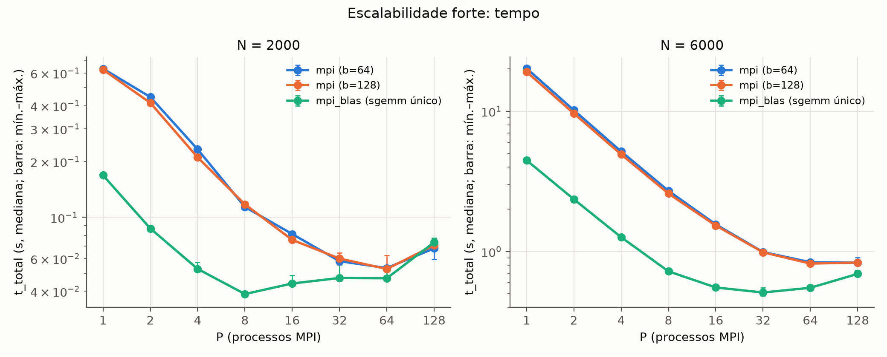

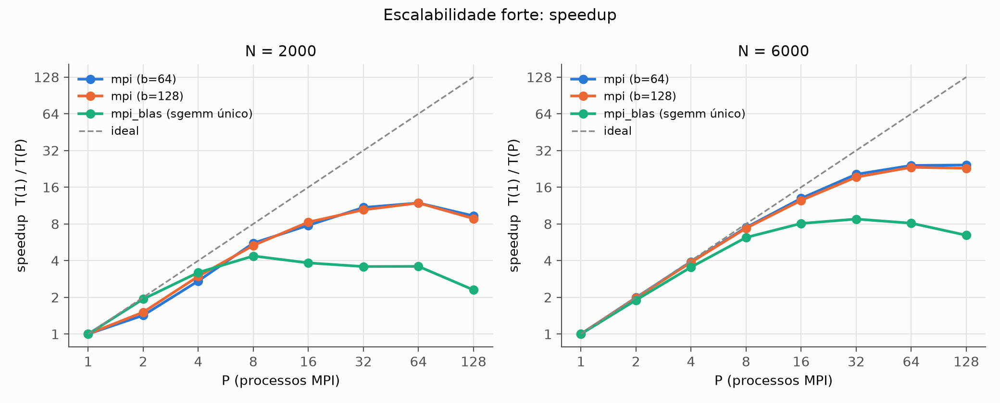

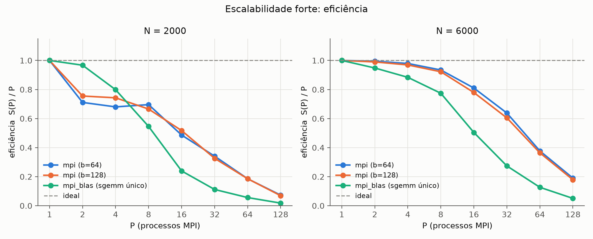

**N = 6000:**

| P | `mpi` b = 128: t (s) | S | E | `mpi_blas`: t (s) | S | E |
|---|---|---|---|---|---|---|
| 1 | 19,070 | 1,00 | 1,00 | 4,464 | 1,00 | 1,00 |
| 2 | 9,632 | 1,98 | 0,99 | 2,354 | 1,90 | 0,95 |
| 4 | 4,919 | 3,88 | 0,97 | 1,263 | 3,54 | 0,88 |
| 8 | 2,585 | 7,38 | 0,92 | 0,721 | 6,19 | 0,77 |
| 16 | 1,529 | 12,47 | 0,78 | 0,553 | 8,07 | 0,50 |
| 32 | 0,985 | 19,35 | 0,60 | **0,509** | **8,77** | 0,27 |
| 64 | **0,819** | **23,29** | 0,36 | 0,550 | 8,11 | 0,13 |
| 128 | 0,833 | 22,90 | 0,18 | 0,691 | 6,46 | 0,05 |

**N = 2000:**

| P | `mpi` b = 128: t (s) | S | E | `mpi_blas`: t (s) | S | E |
|---|---|---|---|---|---|---|
| 1 | 0,626 | 1,00 | 1,00 | 0,169 | 1,00 | 1,00 |
| 8 | 0,118 | 5,32 | 0,67 | **0,039** | **4,37** | 0,55 |
| 64 | **0,053** | **11,88** | 0,19 | 0,047 | 3,59 | 0,06 |
| 128 | 0,071 | 8,85 | 0,07 | 0,073 | 2,30 | 0,02 |

Com b = 64 os resultados são praticamente iguais (S = 24,3 com P = 128 para N = 6000).

**Para onde vai o tempo.** A figura abaixo divide t_total entre distribuição, conta local e coleta.

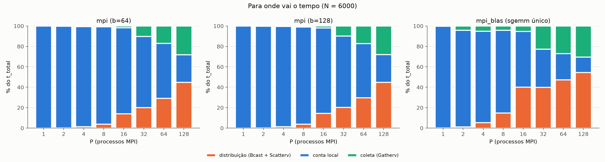

- Para N = 6000 no kernel próprio, a eficiência fica acima de 0,9 até P = 8, quando a comunicação é menos de 5% do tempo. Com P = 128, distribuição e coleta somam **73%** do tempo.
- A conta local continua escalando: `t_comp` cai de 19,05 s para 0,226 s, um **speedup de 84 só na computação**. O que limita o speedup total em ~23 é a comunicação, que não diminui com P. O `t_dist` passa de 0,22 s (P = 16) para 0,37 s (P = 128), porque o `MPI_Bcast` de B (144 MB) precisa chegar a mais processos e tudo sai do processo 0.
- A **métrica de Karp–Flatt**, e = (1/S − 1/P) / (1 − 1/P), estima a fração serial a partir do speedup medido. Para N = 6000 e b = 128 ela vale 0,010 (P = 2), 0,012 (P = 8), 0,019 (P = 16), 0,028 (P = 64) e 0,036 (P = 128). Se a perda viesse de uma parte serial fixa (lei de Amdahl pura), e seria constante. Como **e cresce com P**, a perda vem de um **custo que aumenta com o número de processos**, que é a comunicação coletiva.
- O `mpi_blas` satura mais cedo (P = 32 para N = 6000; P = 8 para N = 2000). A comunicação é a mesma do `mpi`, mas a conta é 4,3 vezes mais rápida, então a comunicação passa a dominar com menos processos. Com P = 128 ela é 85% do tempo. **Quanto mais rápido o kernel, pior a escalabilidade, embora o tempo absoluto seja sempre menor.**
- Mesmo saturado, o `mpi_blas` com P = 32 (0,509 s) é 1,6 vezes mais rápido que o melhor caso do `mpi` (0,819 s com P = 64), usando metade dos núcleos.
- Com N = 2000 há pouco trabalho por processo: com P = 128 cada processo multiplica cerca de 16 linhas, e o tempo **piora** em relação a P = 64.

### 5.5 Escalabilidade fraca

Trabalho por processo constante: o total é 2N³ e cada processo faz 2N³/P, então N_P = 2000·∛P. A eficiência fraca é E(P) = T(1, N₁) / T(P, N_P); o ideal é 1.

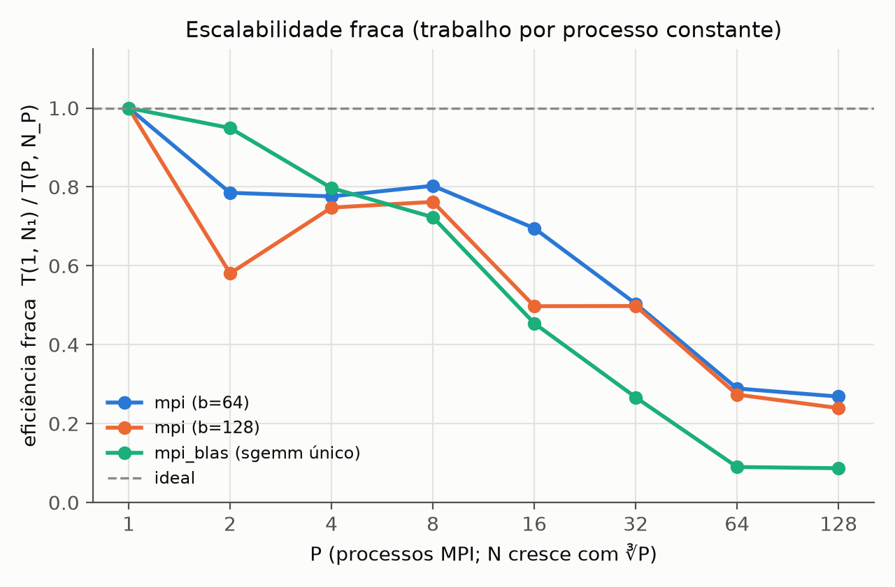

| P | N | `mpi` b = 64: t (s) | E | `t_comp` | `t_dist + t_gather` | `mpi_blas`: t (s) | E |
|---|---|---|---|---|---|---|---|
| 1 | 2000 | 0,670 | 1,00 | 0,667 | 0,003 | 0,167 | 1,00 |
| 2 | 2520 | 0,853 | 0,79 | 0,832 | 0,020 | 0,176 | 0,95 |
| 4 | 3175 | 0,863 | 0,78 | 0,783 | 0,063 | 0,210 | 0,80 |
| 8 | 4000 | 0,834 | 0,80 | 0,770 | 0,055 | 0,231 | 0,72 |
| 16 | 5040 | 0,963 | 0,70 | 0,821 | 0,153 | 0,368 | 0,45 |
| 32 | 6350 | 1,329 | 0,50 | 0,991 | 0,340 | 0,628 | 0,27 |
| 64 | 8000 | 2,318 | 0,29 | 1,175 | 1,150 | 1,862 | 0,09 |
| 128 | 10079 | 2,494 | 0,27 | 1,304 | 1,206 | 1,929 | 0,09 |

A eficiência cai por dois motivos:

1. **A comunicação não é "trabalho por processo constante".** Mesmo com a conta por processo fixa, cada processo recebe B inteira (N² floats), e N² cresce como P^(2/3). O volume total que sai do processo 0 é da ordem de P·N², ou seja, P^(5/3). De P = 32 para P = 64, `t_dist + t_gather` passa de 0,34 s para 1,15 s.
2. **A própria conta fica mais lenta.** `t_comp` deveria ficar constante (cerca de 0,67 s), mas chega a 1,30 s com P = 128. Com o nó cheio, os processos disputam a banda de memória e a L3 (que passa de 16 MiB para cerca de 4 MiB por núcleo). Além disso, cada processo percorre uma B maior (406 MB para N = 10079), que não cabe em nenhuma cache.

Ainda assim, o desempenho total cresce: de 24 GFLOP/s (P = 1) para 821 GFLOP/s (P = 128) no kernel próprio, e de 96 para 1062 GFLOP/s no `mpi_blas`.

### 5.6 Processos × threads: modo híbrido

N = 6000, `mpi_blas` com uma chamada de `sgemm` por processo, sempre 128 núcleos (P processos × T threads).

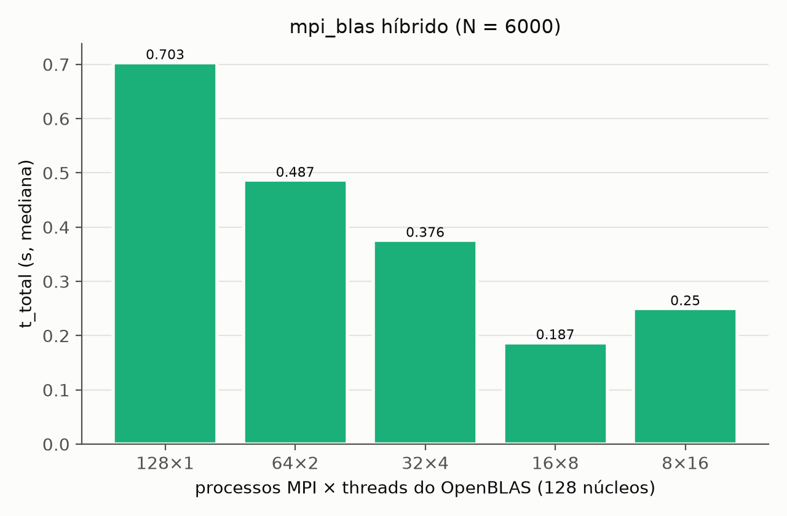

| P × T | t_total (s) | `t_dist` | `t_comp` | `t_gather` | GFLOP/s |
|---|---|---|---|---|---|
| 128 × 1 | 0,703 | 0,383 | 0,103 | 0,217 | 614 |
| 64 × 2 | 0,487 | 0,270 | 0,088 | 0,130 | 888 |
| 32 × 4 | 0,376 | 0,193 | 0,075 | 0,108 | 1149 |
| **16 × 8** | **0,187** | 0,081 | 0,076 | 0,031 | **2306** |
| 8 × 16 | 0,250 | 0,144 | 0,079 | 0,027 | 1729 |

- **16 processos × 8 threads é 3,8 vezes mais rápido que 128 processos × 1 thread**, com os mesmos 128 núcleos. Foi o melhor resultado do trabalho: 2,3 TFLOP/s, cerca de 28% do pico do nó na frequência base.
- A conta custa quase o mesmo em todas as combinações (0,075 a 0,10 s). As threads do OpenBLAS paralelizam o `sgemm` tão bem quanto os processos. **O ganho vem inteiro da comunicação**: com menos processos, B é replicada menos vezes (16 cópias em vez de 128) e o processo 0 atende menos destinos.
- Com 8 × 16 o `t_dist` volta a subir. Uma explicação provável é a escolha de algoritmo do `MPI_Bcast` do Open MPI para poucos processos com mensagens grandes; não foi investigado.

### 5.7 Número de nós

N = 6000, job 1035879 na fila `paralela`, 2 nós exclusivos (adano08 e adano14). Cada P rodou no mesmo job de duas formas: **compactado**, com todos os processos no primeiro nó (`--map-by core`), e **espalhado**, com metade em cada nó (`--map-by ppr:P/2:node`). O `mpi` usa b = 128 e o `mpi_blas`, uma chamada de `sgemm` por processo. A coluna "razão" é o tempo em 2 nós dividido pelo tempo em 1 nó: abaixo de 1, espalhar é mais rápido.

| P | `mpi`: 1 nó (s) | 2 nós (s) | razão | `mpi_blas`: 1 nó (s) | 2 nós (s) | razão |
|---|---|---|---|---|---|---|
| 16 | 1,598 | 1,642 | 1,03 | 0,597 | 0,533 | 0,89 |
| 32 | 1,006 | 1,034 | 1,03 | 0,534 | 0,420 | 0,79 |
| 64 | 0,832 | 0,613 | 0,74 | 0,548 | 0,379 | 0,69 |
| 128 | 0,823 | 0,499 | 0,61 | 0,739 | **0,346** | 0,47 |
| 256 | – | **0,471** | – | – | 0,511 | – |

Decomposição das configurações principais (medianas de cada etapa, que não precisam somar exatamente a mediana do total):

| Configuração | Nós | t_total (s) | `t_dist` | `t_comp` | `t_gather` | GFLOP/s |
|---|---|---|---|---|---|---|
| `mpi`, P = 128 | 1 | 0,823 | 0,379 | 0,229 | 0,216 | 525 |
| `mpi`, P = 128 | 2 | 0,499 | 0,213 | 0,244 | 0,042 | 866 |
| `mpi`, P = 256 | 2 | 0,471 | 0,266 | 0,143 | 0,053 | 917 |
| `mpi_blas`, P = 128 | 1 | 0,739 | 0,409 | 0,105 | 0,223 | 585 |
| `mpi_blas`, P = 128 | 2 | 0,346 | 0,204 | 0,105 | 0,035 | 1250 |
| `mpi_blas`, P = 256 | 2 | 0,511 | 0,304 | 0,124 | 0,083 | 845 |
| `mpi_blas`, 16 × 8 | 1 | **0,201** | 0,086 | 0,079 | 0,037 | **2152** |
| `mpi_blas`, 32 × 8 (16 × 8 por nó) | 2 | 0,275 | 0,164 | 0,079 | 0,039 | 1572 |

- **A hipótese inicial não se confirmou.** Esperávamos que passar pela rede piorasse o tempo. Na mediana, ocorreu o contrário a partir de P = 64: com P = 128, espalhar reduziu o tempo em 39% no `mpi` e em 53% no `mpi_blas`. Só o `mpi` com P ≤ 32 ficou mais lento, e apenas 3%.
- **O ganho vem inteiro da comunicação.** O `t_comp` praticamente não muda entre os dois arranjos. Com P = 128 no `mpi_blas`, o total cai 0,393 s: 0,205 s no `t_dist` e 0,188 s no `t_gather`.
- **Dobrar os núcleos quase não ajuda.** Passar de P = 128 espalhado para P = 256 melhora o `mpi` em 6% (0,499 s para 0,471 s) e **piora** o `mpi_blas` em 48% (0,346 s para 0,511 s). O melhor `mpi_blas` sem threads em 2 nós usa só metade dos núcleos reservados.
- **O híbrido continua sendo o melhor, mas em 1 nó.** Com o dobro dos núcleos, 32 × 8 em 2 nós é 37% mais lento que 16 × 8 em 1 nó: o `t_comp` fica igual e o `t_dist` quase dobra. Em 2 nós, ele ainda supera o melhor `mpi_blas` sem threads (0,275 s contra 0,346 s).
- **A primeira repetição é muito mais lenta quando há rede.** Com P = 256, ela levou 8,80 s no `mpi` e 10,24 s no `mpi_blas`, cerca de 19 e 20 vezes a mediana, com o excesso todo em `t_dist` e `t_gather`. Com P = 128 espalhado, levou 1,36 s e 1,12 s, **mais que** o compactado na mesma repetição (0,82 s e 0,80 s). A mediana esconde esse custo: quem faz uma única multiplicação por execução não recebe o ganho da tabela. A causa provável é o estabelecimento das conexões no primeiro uso; não foi investigada.

**Possíveis causas (hipóteses não testadas).** Este experimento não isola o efeito da rede, porque espalhar também divide pela metade a carga em cada nó: com P = 128, cada nó guarda 64 cópias de B em vez de 128 e tem o dobro de banda de memória por processo. O `t_dist` é compatível com isso, pois P espalhado fica próximo de, ou abaixo de, P/2 compactado (0,204 s contra 0,258 s no `mpi_blas` com P = 128). Já o `t_gather` cai muito mais do que essa explicação prevê (0,035 s contra 0,147 s), o que sugere que o Open MPI escolhe outro algoritmo ou outro transporte quando há mais de um nó. Não registramos essa escolha. O `t_comp` do `sgemm` também parou de cair (0,105 s para 0,124 s entre P = 128 e 256), enquanto o do kernel próprio continua caindo (0,244 s para 0,143 s). Uma explicação possível é o empacotamento de B dentro do `sgemm`, cujo custo não diminui com P, porque cada processo multiplica pela matriz B inteira.

**Conferência.** As configurações compactadas reproduzem os jobs de 1 nó (1035722 e 1035725) com diferença de até 8%: por exemplo, 0,823 s contra 0,833 s no `mpi` com P = 128 e 0,201 s contra 0,187 s no 16 × 8.

---

## 6. Discussão

**Onde está o gargalo.** Com poucos processos, o gargalo é a computação, e a escalabilidade é quase ideal (E ≥ 0,92 até P = 8 com N = 6000). Com muitos processos, o gargalo passa a ser a **comunicação centralizada** da estratégia por faixas de linhas: o `Bcast` de B inteira e o `Gatherv` de C passam pelo processo 0, e o volume não diminui com P. A computação sozinha teve speedup de 84 com P = 128, mas o total ficou em 23.

**Por que o OpenBLAS ganha tanto.** Com 1 thread o `sgemm` atingiu de 96 a 100 GFLOP/s, cerca de 4,5 vezes o kernel em blocos (cerca de 21 GFLOP/s) e mais de 45 vezes o `ijk`. Isso fica perto do pico de um núcleo com boost (~105 GFLOP/s). O OpenBLAS usa microkernels em assembly com FMA e vetores AVX2, registradores como bloco mais interno, empacota os blocos de A e B em memória contígua e escolhe os tamanhos de bloco para cada nível de cache do Zen 2. O kernel próprio foi compilado sem FMA (para manter a igualdade bit a bit entre os kernels) e depende do autovetorizador do GCC, sem blocagem em registradores.

**Por que a eficiência cai.**
- Na escalabilidade forte, a computação por processo diminui como 1/P, mas a comunicação não. A métrica de Karp–Flatt crescente confirma que a perda é um custo que cresce com P, e não uma parte serial fixa.
- Na escalabilidade fraca, a comunicação cresce mais que o trabalho, porque B é replicada e o volume vai com P^(5/3). Além disso, com o nó cheio a conta disputa banda de memória.
- Quanto mais rápido o kernel, mais cedo a comunicação domina. Por isso o `mpi_blas` escala pior que o `mpi`, embora seja sempre mais rápido.

**Memória.** Replicar B custa P·N²·4 bytes. Para N = 10079 e P = 128 isso dá 52 GB num nó, que ainda cabe nos 502 GiB, mas limita o N máximo e consome banda de memória. O modo híbrido reduz esse custo pelo fator T.

**Efeito da rede entre nós.** Ao contrário do esperado, usar dois nós não piorou o tempo mediano na maioria dos casos: com P ≥ 64 ele melhorou (seção 5.7). Isso sugere que, para esta estratégia, o limite dentro de um nó cheio não é só o volume de dados, mas também a forma como eles chegam a 128 processos no mesmo nó. O ganho, porém, tem limites claros: dobrar os núcleos quase não ajuda, o `mpi_blas` com P = 256 piora e a primeira repetição pode ser 20 vezes mais lenta. O melhor resultado continua sendo o híbrido em um nó. Isso reforça a necessidade de algoritmos com comunicação distribuída.

---

## 7. Limitações e variabilidade

### 7.1 Variabilidade entre repetições

Na maioria das configurações, a diferença entre o mínimo e o máximo das 5 repetições é menor que 2% (barras de erro nos gráficos). A variação cresce com P: com P = 128, o máximo chega a ficar até ~20% acima da mediana (por exemplo, no weak com N = 10079), sempre por causa do `t_dist` ou do `t_gather`. No job de blocos, uma repetição do `mpi_blas` com P = 128 chegou a 4,6 s, contra 1,2 s de mediana. Por isso usamos a mediana, que não é afetada por uma repetição isolada lenta.

### 7.2 P = 2 com tempo de coleta alto

Em algumas configurações com P = 2 o `t_gather` ficou de 0,05 a 0,14 s, quando o esperado seria cerca de 0,01 s. Isso aconteceu no strong com N = 2000 e no weak com b = 128. Por isso a eficiência forte com N = 2000 é 0,71 a 0,76 em P = 2, e a eficiência fraca do `mpi` com b = 128 cai para 0,58 em P = 2 e volta a 0,75 em P = 4. A causa provável é o protocolo de mensagens grandes do Open MPI entre dois processos; não foi investigada.

### 7.3 Diferença entre jobs no mesmo nó

Os jobs de blocos, forte e tamanhos rodaram no mesmo nó (adano37), em momentos diferentes. Com N = 6000 e b = 128, os três concordam em 1% com P = 16 (1,52 s). Com P = 1 o job de blocos foi 8% mais lento (20,7 s contra 19,1 s). Com P = 128 a diferença é grande: o job de blocos mediu 1,27 s, contra cerca de 0,83 s nos outros dois, e a diferença está toda no `t_dist` (0,81 s contra 0,37 s). Por isso, com P = 128, só comparamos configurações **dentro de um mesmo job**. Os jobs reduzidos de garantia na fila `testes` (1035736 e 1035737, P ≤ 4) não entraram nos gráficos.

### 7.4 Número de nós

O experimento de nós (seção 5.7) é pequeno: um único job, um único par de nós (adano08 e adano14), N = 6000 e no máximo 2 nós, porque a fila `paralela` é a única com vários nós e exige no mínimo 2 nós e 256 núcleos. Ele tem quatro limitações:

- **Não isola a rede**: espalhar os processos também reduz a carga em cada nó, e os dois efeitos aparecem juntos.
- **Não caracteriza a rede**: não medimos latência nem banda, nem registramos o transporte e o algoritmo de coletiva usados pelo Open MPI.
- **Ligação não conferida**: este job não usou `--report-bindings`, então a ligação dos processos e threads não foi confirmada diretamente, como foi no híbrido de 1 nó.
- **Variabilidade**: a rede é compartilhada com outros jobs, e as 5 repetições de um único job não medem a variação entre execuções. A primeira repetição das execuções espalhadas é um valor atípico sistemático (até 20 vezes a mediana), e por isso os ganhos da seção 5.7 valem depois do aquecimento.

---

## 8. Conclusão

As três versões foram implementadas e validadas: todas as execuções ficaram com erro relativo abaixo de 10⁻⁴, o erro cresce com √N como prevê a análise de arredondamento, e o modo MPI dá resultados idênticos bit a bit ao serial.

Os principais resultados:
- a ordem dos laços muda o tempo serial em 10 vezes;
- o melhor bloco do kernel próprio é o que mantém os três blocos na L2 (b de 64 a 256);
- o OpenBLAS é 4,5 vezes mais rápido que o kernel próprio e funciona melhor sem blocagem externa;
- a escalabilidade forte é quase ideal até P = 8 e satura em P = 64 (kernel próprio) ou P = 32 (OpenBLAS), por causa da comunicação centralizada;
- a melhor configuração do nó foi a híbrida, 16 processos × 8 threads, com 2,3 TFLOP/s;
- em dois nós, espalhar os processos reduziu o tempo mediano em até 53% com P = 128, mas usar 256 núcleos quase não ajudou, e a melhor configuração medida continuou sendo a híbrida em um nó.

**Melhorias possíveis:**
- **Algoritmos com comunicação distribuída** (SUMMA ou Cannon): B também é dividida, a memória por processo cai de N² para N²/P e a comunicação deixa de passar pelo processo 0.
- **Sobrepor comunicação e cálculo** com coletivas não bloqueantes (`MPI_Ibcast`, `MPI_Iscatterv`), começando a multiplicar as primeiras faixas enquanto as outras chegam.
- **Modo híbrido por padrão**: um processo por domínio NUMA ou por par de domínios, com threads do OpenBLAS dentro.
- **Isolar o efeito da rede**: medir latência e banda entre os nós, registrar o transporte e o algoritmo de coletiva usados pelo Open MPI e repetir com mais nós e em mais de um job.

---

## Apêndice: como compilar e executar

As instruções completas estão no `README.md` do repositório. Resumo:

```bash
# compilar no Lovelace (nó de cálculo)
qsub scripts/build.pbs

# experimentos (da raiz do projeto)
qsub scripts/correctness.pbs
qsub scripts/strong.pbs      # idem: serial, blocks, sizes, weak, hybrid, nodes

# execução avulsa
mpirun -np 4 ./build/src/matmul --mode mpi_blas --n 2000 --block 2000 --reps 5 --verify --header

# figuras e tabelas
python3 analysis/plots.py --results results --out analysis/figures
```
